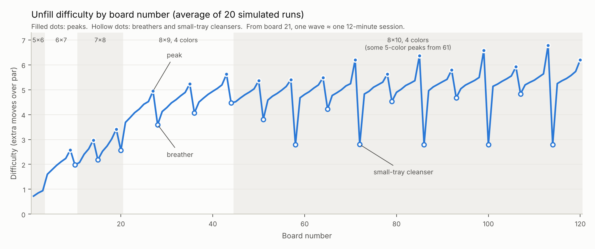

# gen/: the board library generator

`npm run gen` generates, solves, measures, rates and filters boards, and writes:

- `src/library/boards.json`: the board library that ships with the game (one board per line).
- `gen/REPORT.md`: each tier's metrics against its targets, the solver checks, and a 100-board progression preview.

```sh
npm run gen                     # the full library, 2,400 boards (about 10 minutes on 4 cores)
npm run gen -- --scale 0.05     # a quick small library for trying changes
npm run gen -- --tiers 1,2 --threads 8 --out /tmp/x.json --report /tmp/x.md
```

The output is deterministic. Board `index` of tier `t` always comes from the same seed, candidates are kept in
index order, and the solver and simulated players use no clock and no `Math.random`. The same code writes the
same file on any machine with any number of threads, and a test rebuilds sampled boards to prove it.

## The pipeline, per candidate board

1. **Generate** with the plan's generator (pieces of 2–4 blocks that avoid touching their own color), full tray.
2. **Solve** with beam search, width 500, ranked by groups left (`beamSolve` in `src/core/solver.ts`).
3. **Check par with exact search** on tiers 1–3 (5×6, 6×7, 7×8): IDA* asks "is there any solution shorter than
   the beam's?" within a node budget. If it finds one, that becomes par.
4. **Replay** the solution in the shared rules code; it must empty the tray.
5. **Filter** by the tier's targets (below), cheapest checks first.
6. **Rate difficulty** with the simulated players (below).
7. **Deduplicate**: a board that is a mirror image or recoloring of one already kept is dropped.

## Tiers and targets (column gravity)

| Tier | Board numbers | Size | Colors | Boards | Par range | Careful gap | Naive gap | Singles | Opening groups |
| --- | --- | --- | --- | --- | --- | --- | --- | --- | --- |
| 1 | 1–3 (tutorial) | 5×6 | 3 | 150 | 5–8 | any | any | ≤ 25% of par | ≥ 8 |
| 2 | 4–10 | 6×7 | 3 | 250 | 6–9 | ≥ 1 | ≥ 1 | ≤ 25% | ≥ 8 |
| 3 | 11–20, cleansers | 7×8 | 3 | 350 | 7–11 | ≥ 1 | ≥ 1 | ≤ 25% | ≥ 8 |
| 4 | 21–40 | 8×9 | 4 | 500 | 10–15 | ≥ 1 | ≥ 1 | ≤ 25% | ≥ 8 |
| 5 | 41+ | 8×10 | 4 | 750 | 11–17 | ≥ 1 | ≥ 1 | ≤ 25% | ≥ 8 |
| 6 | peaks from 61 | 8×10 | 5 | 400 | 13–19 | ≥ 1 | ≥ 1 | ≤ 25% | ≥ 8 |

- **Careful gap** (plan): the one-move-lookahead player's moves minus par. At least 1 after the tutorial, so
  thinking always pays.
- **Naive gap**: the biggest-group-first player's moves minus par. At least 1, so the obvious play is never
  already perfect.
- **Singles**: single-block lifts in the par solution, capped at a quarter of par (plan).
- **Par ranges** trim the rare unusually short or long boards of each size, from the measured distributions.

With column gravity and full trays, par runs 18–33% higher than the plan's repose figures (for example 8×10 with 4
colors: 13.1 versus 9.9). Part of that is the rule and part is that the plan's experiment left the top row empty.
`gen/REPORT.md` has the measured averages for the shipped library.

Exact search proved par minimal on every 5×6 and 6×7 board and on 326 of 350 7×8 boards (the other 24 ran out of
node budget). It beat the beam on 2 of the 7×8 boards, so the beam is very good but not perfect there; those two
got the shorter par. On the 8×9 and 8×10 tiers par is the beam's answer. Either way the guarantee holds: par is a
real, replayed solution, so the grant is always enough.

## How difficulty is rated

Will asked for the best way to rate a board's difficulty, so I measured it rather than guessing.

**The rating.** Three simulated, imperfect players play each board many times: *casual* (often picks a good lift,
sometimes a worse one), *medium* (usually picks among the best lifts) and *sharp* (thinks two taps ahead, with a
little noise). Each scores every possible lift by how many groups it leaves and picks at random, weighted toward
better lifts (`noisyPlay` in `src/core/solver.ts`). A board's rating is the average number of extra moves over par
they need, averaged over the three players (`metrics.excess100`, in hundredths of a move). It's in moves, so it
reads directly against the move budget: a board rated 5.0 means a typical player needs about par + 5.

**Why this rating.** On 640 boards across all six tiers (`gen/study/`), I compared nine candidate measures with
the player rating, using rank correlation within each tier (1.0 = same order, 0 = unrelated):

| Measure | Correlation with how much players struggle |
| --- | --- |
| Simulated player rating, split-half (its own consistency) | 0.82–0.88 |
| Share of costly choices per step | 0.49–0.70 |
| Careful-player gap (plan) | 0.42–0.62 |
| Random-player gap | 0.49–0.69 |
| Key moves (plan) | 0.01–0.59 (near 0 on small boards) |
| Naive-player gap | 0.22–0.43 |
| Opening choices | 0.06–0.38 |
| Singles in the par solution | about 0 |
| Par | −0.10 to −0.30 (longer boards are slightly *easier* to play well) |

No cheap measure predicts difficulty well; the best single one explains about half the ordering. The player
simulation is consistent with itself (0.82–0.88 between two independent halves of its runs) and costs under a
second per board, so it's the rating. The plan's key-moves measure was the slowest and one of the weakest, so it
isn't used. The players also disagree with each other more than you'd expect (sharp vs casual: 0.41–0.65): a board
that traps a casual player can be easy for a sharp one. That's why the rating averages all three, and why the
library stores each player's number separately (`metrics.players`). After the playtest week, the weights can be
tuned toward whichever player plays most like her, without regenerating the library.

## Progression: the sawtooth



`src/core/progression.ts` decides which board comes next (`slotFor`, `pickBoard`).

- **Tiers by board number**: 1–3 tutorial, 4–10, 11–20, 21–44, then 45 onward (the plan's tiers, with tier 4
  four boards longer so it holds three whole waves).
- **Waves**: building boards, then a peak, then a breather. Wave lengths (7, 5, 8 and 7 boards by tier) are fitted
  so that from board 21 one wave takes a typical player about one 12-minute session, Block Blast's average (see
  gen/economy/README.md). Building boards climb from −100 to +100 rank around the tier's rising base, the peak is
  +250 and the breather −250 (out of 1000). The wave restarts with each tier, so a new tray size never opens on a
  peak.
- **Rising base**: the base climbs through each tier (from rank 200 to 600), and through the first 100 boards of
  the endless tier (250 to 700), then holds. Each new tier is harder across the board, so difficulty steps up at
  every tier change.
- **Five colors and palette cleansers**: from board 61, every other peak is a five-color 8×10 board, and the wave
  that has it ends on a small 7×8 tray instead of a normal breather (every other breather from board 45).
- **Picking**: among the boards of that tier not played in the last 200, one of the eight closest to the target
  rank, at random with a seeded generator, shown with a random mirror and color order.

The tests check the shape on the real library over five 200-board runs: each tier is harder on average than the
one before, the later half of a tier is harder than the earlier half, and over 90% of peaks are harder than their
building boards and over 90% of breathers easier than their peak.

The move economy (milestone 3, `src/core/economy.ts`) rides the same wave: less slack on peaks, more on breathers.

## Files

- `cli.ts`: the command; runs `evaluate` on worker threads, keeps boards in order, ranks, writes outputs.
- `evaluate.ts`: one candidate: generate, solve, exact check, replay, filter, rate.
- `tiers.ts`: tier sizes, counts, targets, beam width and the simulated player population.
- `report.ts`: writes `REPORT.md`.
- `study/`: the difficulty study (`measure.ts`, `analyze.ts`) and its saved data.
