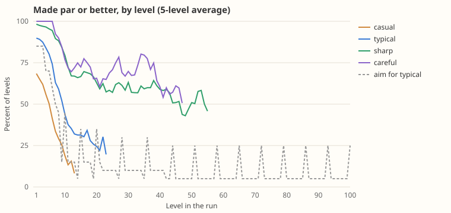
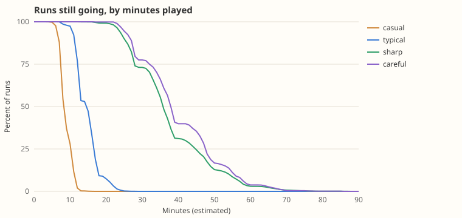
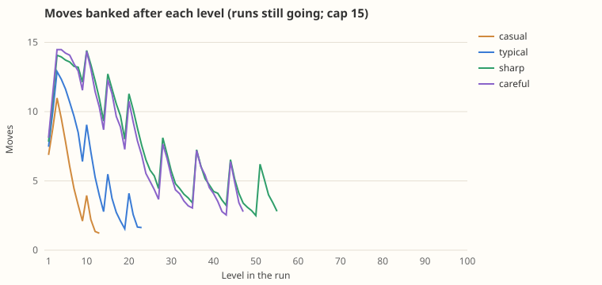

# Tuning report (milestone 7)

Generated by `npm run tuning` -- --report. Do not edit by hand.

5,000 runs per bot on the shipped TUNING.

Play time is estimated at 5 s per lift plus 8 s per level (src/core/pacing.ts) until her playtest gives real times.

## Targets

| Check | Result | Target | |
| --- | --- | --- | --- |
| Typical: median run length | 14.6 min | 12–15 min | ok |
| Typical: runs over before 5 minutes | 0% | ≤ 10% | ok |
| Typical: make par or better, levels 1–10 | 73% | 70–95% | ok |
| Typical: make par or better, levels 11–20 | 31% | 35–50% | **miss** |
| Typical: beat par, all levels | 30% | about 30% | ok |
| Typical: exactly par, all levels | 31% | about 25% | ok |
| Typical: over par, all levels | 39% | about 45% | ok |
| Casual: median run length | 8.0 min | ≥ 6 min | ok |
| Sharp: beat par, worst level band | 25% | ≥ 20% | ok |
| Sharp: median run length | 35.8 min | ≤ 40 min | ok |
| Sharp: runs still going at level 200 | 0% | ≤ 5% | ok |
| Typical: runs that end on a peak | 40% | ≥ 50% | **miss** |
| Typical: runs that end 3 or fewer moves short | 89% | ≥ 50% | ok |
| Typical: levels started with fewer moves than par | 2% | ≤ 5% | ok |
| Guarantees: levels where par could not be beaten (by the solver, or with the moves in hand) | 0 | 0 | ok |

## Tuning

```json
{
  "makePar": [
    [
      1,
      75
    ],
    [
      5,
      70
    ],
    [
      11,
      15
    ],
    [
      51,
      5
    ]
  ],
  "roleShift": {
    "tutorial": 10,
    "build": 0,
    "peak": -20,
    "breather": 20,
    "cleanser": 20
  },
  "minCushion": 1,
  "bonus": {
    "tutorial": 2,
    "build": -1,
    "peak": -1,
    "breather": 3,
    "cleanser": 3
  },
  "welcomeGift": 5,
  "bankCap": 15
}
```

## Runs by bot

| Bot | Median run | Middle half | 10%–90% | Levels (median, 10%–90%) | Under 5 min | Median score | Beat / par / over | Started below par |
| --- | --- | --- | --- | --- | --- | --- | --- | --- |
| casual (quick, loose taps) | 8.0 min | 7.4–10.1 min | 6.7–11.0 min | 8 (6–11) | 0% | 1,315 | 22 / 28 / 50% | 3.0% |
| typical | 14.6 min | 12.1–16.5 min | 11.3–17.7 min | 15 (12–18) | 0% | 2,740 | 30 / 31 / 39% | 2.2% |
| sharp (thinks two taps ahead) | 35.8 min | 27.8–44.8 min | 25.0–54.1 min | 32 (24–46) | 0% | 8,665 | 44 / 30 / 27% | 1.7% |
| careful (same greedy line every time) | 38.0 min | 32.0–47.5 min | 26.5–55.4 min | 34 (25–46) | 0% | 8,875 | 40 / 39 / 21% | 1.9% |

## How each level band goes

Share of levels played in the band: beat par / exactly par / over par / ran out (the run ended there).

| Levels | casual | typical | sharp | careful |
| --- | --- | --- | --- | --- |
| 1–10 | 21 / 26 / 45 / 7 | 41 / 32 / 27 / 0 | 68 / 25 / 7 / 0 | 67 / 28 / 5 / 0 |
| 11–20 | 3 / 6 / 40 / 52 | 8 / 23 / 54 / 15 | 32 / 35 / 32 / 0 | 18 / 54 / 28 / 0 |
| 21–30 | (few runs get here) | 6 / 14 / 39 / 42 | 31 / 28 / 38 / 3 | 35 / 32 / 30 / 3 |
| 31–45 | (few runs get here) | (few runs get here) | 34 / 25 / 30 / 11 | 35 / 36 / 20 / 9 |
| 46–60 | (few runs get here) | (few runs get here) | 25 / 21 / 34 / 19 | 17 / 33 / 30 / 20 |
| 61–80 | (few runs get here) | (few runs get here) | (few runs get here) | (few runs get here) |
| 81–200 | (few runs get here) | (few runs get here) | (few runs get here) | (few runs get here) |

## How runs end

| Bot | End on a peak | 1 move short | 3 or fewer short |
| --- | --- | --- | --- |
| casual (quick, loose taps) | 35% | 33% | 80% |
| typical | 40% | 42% | 89% |
| sharp (thinks two taps ahead) | 26% | 50% | 94% |
| careful (same greedy line every time) | 31% | 56% | 96% |

## Charts






